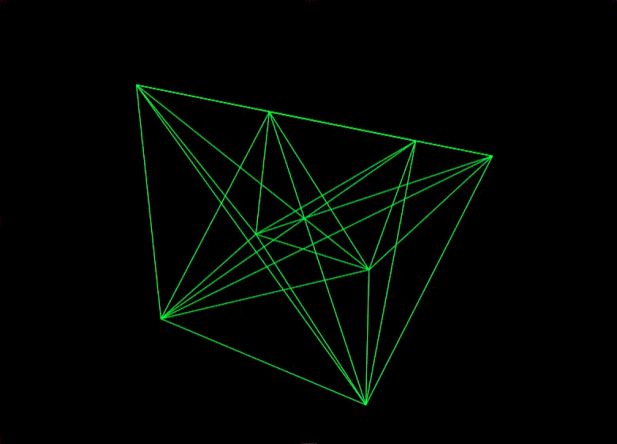

# Cube

A simple 3D rotating wireframe cube rendered in 2D using Kotlin and Java Swing.



## Features

- Real-time 3D rotation projection onto a 2D canvas.
- Built with Kotlin and Swing.

## Future Improvements / Ideas

Here are some potential enhancements and features that are not yet implemented:

- **Local Center of Rotation**: Rotate figures around their centroid / local center rather than the global origin.
- **Custom Meshes via CSV / Files**: Load vertices and edges dynamically from a CSV or OBJ file.
- **Edge / Adjacency Matrix**: Use an explicit connection matrix or edge list instead of connecting every vertex to all other vertices.
- **Configurable Projection & Transformations**: Add perspective projection (FOV/camera distance), translation, and scaling controls.
- **Interactive Controls**: Allow user interaction (mouse drag to rotate, keyboard shortcuts, adjustable rotation speed).

## Contributing

Contributions and Pull Requests (PRs) are welcome! If you want to implement any of the ideas above or have other 
improvements in mind, feel free to open a PR or make a fork.

## Requirements

- JDK 8 or higher
- Kotlin

## Running

Run `Main.kt` from your IDE (e.g. IntelliJ IDEA) or compile and run using the Kotlin compiler:

```bash
kotlinc src/*.kt -include-runtime -d cube.jar
java -jar cube.jar
```
